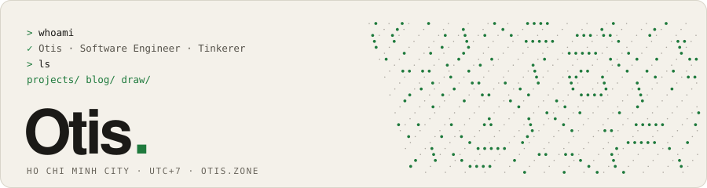
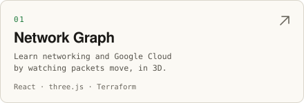
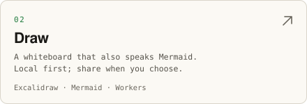
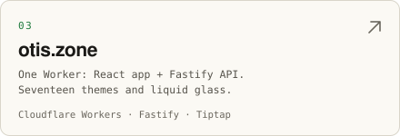
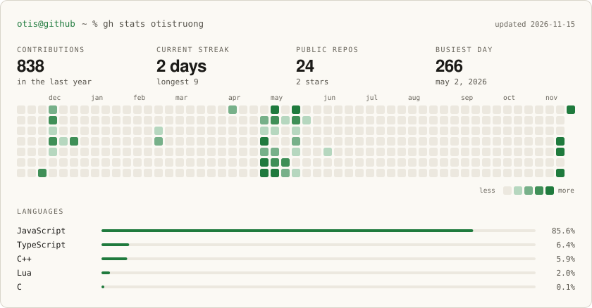

<a href="https://otis.zone"><picture>
  <source media="(prefers-color-scheme: dark)" srcset="assets/banner-dark.svg">
  
</picture></a>

I build small, useful systems, with a bias for calm interfaces and practical engineering.

**[otis.zone](https://otis.zone)** · [blog](https://otis.zone/blog) · [draw](https://otis.zone/draw) · [hello@otis.zone](mailto:hello@otis.zone)

### Now

- Into AI workflows and local-first tools.
- Shipping small things daily, mostly on Cloudflare Workers.
- Teaching networking in 3D with [Network Graph](https://network-graph-sigma.vercel.app).

### Things I've built

<a href="https://network-graph-sigma.vercel.app"><picture>
  <source media="(prefers-color-scheme: dark)" srcset="assets/network-graph-dark.svg">
  
</picture></a>
<a href="https://otis.zone/draw"><picture>
  <source media="(prefers-color-scheme: dark)" srcset="assets/draw-dark.svg">
  
</picture></a>
<a href="https://otis.zone"><picture>
  <source media="(prefers-color-scheme: dark)" srcset="assets/otis-zone-dark.svg">
  
</picture></a>

### Lately

<picture>
  <source media="(prefers-color-scheme: dark)" srcset="assets/stats-dark.svg">
  
</picture>

**Writing**

<!-- POSTS:START -->
- Nothing published yet. [otis.zone/blog](https://otis.zone/blog) is where it will be.
<!-- POSTS:END -->

**On GitHub**

<!-- ACTIVITY:START -->
- `2026-11-14` starred [visualize-anything](https://github.com/otistruong/visualize-anything)
<!-- ACTIVITY:END -->

<picture>
  <source media="(prefers-color-scheme: dark)" srcset="https://raw.githubusercontent.com/otistruong/otistruong/output/snake-dark.svg">
  
</picture>

Colours are the Midnight and Paper themes of <a href="https://otis.zone">otis.zone</a>'s design system and follow your GitHub light or dark setting. The card, the lists and the snake are redrawn every six hours by this repository's own GitHub Actions; no outside service is involved.
